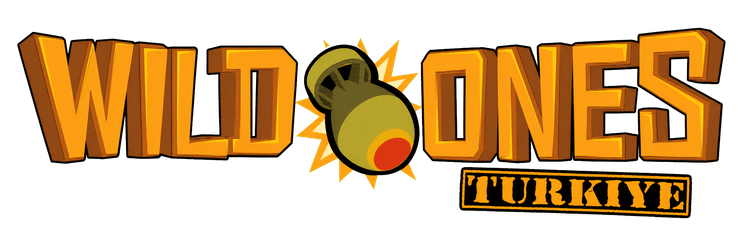
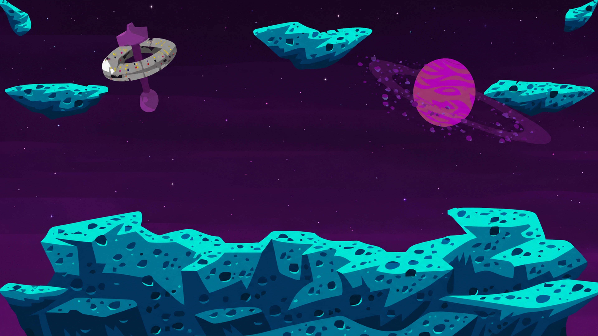
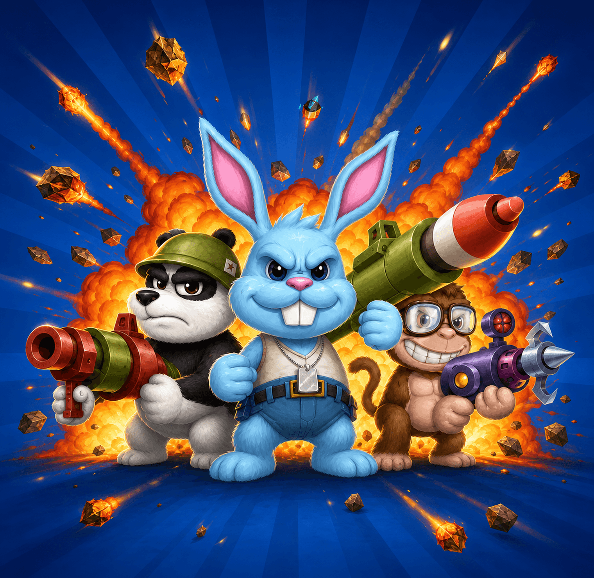

<p align="center">
  
</p>

<h1 align="center">Wild Ones: TURKIYE</h1>

<p align="center">
  A Dockerized preservation server for the Wild Ones v26 Flash client, powered by Ruffle.
</p>

<p align="center">
  <a href="http://45.143.11.212:8085/"><strong>Play on the test server</strong></a>
  ·
  <a href="#quick-start">Quick start</a>
  ·
  <a href="#verification">Verification</a>
</p>



## Overview

Wild Ones: TURKIYE restores the original turn-based artillery experience in a modern browser. The original ActionScript 3 client runs through Ruffle while a Node.js game service implements matchmaking, rooms, combat relay, persistence, leaderboards, pets, inventory, purchases, maps, game modes and server-controlled bots.

The project is designed as a preservation and interoperability effort. It is not affiliated with, endorsed by or sponsored by the original Wild Ones developers or publishers.

## Live test server

The current development build is available at:

**[http://45.143.11.212:8085/](http://45.143.11.212:8085/)**

This is a test environment. Accounts, balance and progression may change while compatibility work continues.

## Highlights

- Original Wild Ones v26 SWF client running in Ruffle
- 24 FPS presentation matching the authored animation timing
- Same-origin WebSocket-to-TCP bridge for browser compatibility
- Persistent MongoDB accounts, inventory, pets and match statistics
- Paged leaderboards with wins, kills, level and player details
- Seven game modes and seven verified maps
- Public matchmaking plus human-only custom rooms
- Server-controlled bots with deterministic profiles and outfits
- Active-pet selection, per-pet statistics and repaired pet abilities
- Server-authoritative, idempotent shop purchases
- Original Collection Raffle rewards and Prize Wheel compatibility
- Canonical projectile relay, health, respawn and terrain synchronization
- Automated SWF, protocol, catalogue, map and UI verification

## Architecture

```text
Browser
  └─ Ruffle + Wild Ones v26 SWF
       └─ WebSocket /socket
            └─ Web service (Node.js)
                 └─ Game TCP service (Node.js)
                      └─ MongoDB
```

Docker Compose starts four services:

| Service | Purpose |
| --- | --- |
| `web` | Authentication, static assets, Ruffle client and WebSocket bridge |
| `game` | Rooms, turns, bots, combat relay, progression and game protocol |
| `mongo` | Persistent account and game data |
| `db-init` | Idempotent schema repair, migration and index creation |

Only the web port is published. MongoDB and the raw game TCP port remain inside the Docker network.

## Gameplay systems

### Game modes

- Point Match
- Team Point Match
- Last One Standing
- Last Team Standing
- Super Speed
- Skill Match
- Custom Game

### Maps

- Critter Falls
- Sink or Swim
- Crash Landing
- Creepy Crawly
- Hot and Spicy
- Lab Rats
- Big Tops

Map capacity is validated against authored spawn locations. Crash Landing and Hot and Spicy are capped at four players.

### Multiplayer synchronization

The firing client renders its projectile immediately from a canonical launch snapshot. The server validates that snapshot and relays it once to the other renderers. Health, score, life generation, terrain revision and respawn state converge through authoritative world snapshots, preventing stale packets from reviving, killing or moving the wrong avatar.

## Quick start

### Requirements

- Docker Engine with Docker Compose
- Node.js 24 for local build and test commands
- PowerShell 7 on Windows when using the helper script

### Docker

```bash
cp .env.example .env
```

Replace both example MongoDB passwords in `.env`, then run:

```bash
docker compose up -d --build
```

Open `http://127.0.0.1:8085/`.

To expose the web service on a remote host, set:

```dotenv
WEB_BIND_HOST=0.0.0.0
WEB_PORT=8085
```

Do not expose MongoDB or the game TCP service directly.
The client runtime is intentionally pinned to the verified v26 SWF; older
`ASSET_VERSION` values from existing environment files are ignored.

### Windows helper

```powershell
.\scripts\docker.ps1 up
.\scripts\docker.ps1 status
.\scripts\docker.ps1 logs
```

`down` preserves the MongoDB volume. `docker compose down -v` permanently removes it.

## Development

Install service dependencies:

```bash
npm run install:deps
```

Run tests:

```bash
npm test
```

Build the runtime catalogues, patched v26 SWF and build metadata:

```bash
npm run build:runtime
```

Run every acceptance gate:

```bash
npm run verify
docker compose config
docker compose build
```

## Verification

The current suite covers:

- Projectile ownership and canonical relay
- Human and bot world-state convergence
- Health generation/revision ordering
- Mass death and single-result settlement
- Safe terrain-aware respawn and renderer acknowledgement
- MIRV child lifetime and turn completion
- Weapon runtime class and icon mapping
- Pet abilities and active-pet authorization
- Room normalization, readiness and map capacity
- Team results and idempotent match progression
- Leaderboard pagination and safe profile projection
- Shop transaction idempotency
- Original Collection Raffle data and rewards
- SWF signatures, embedded JSON and required symbol classes
- English TURKIYE branding and visible UI controls

Health checks:

```bash
curl http://127.0.0.1:8085/health/ready
docker compose ps
```

Every persistent service should report `healthy`.

## Repository layout

```text
docker/          MongoDB initialization
game/            Game server, protocol and persistence
scripts/         Build, migration and verification tools
shared/          Shared catalogues and rules
swf-patches/     Minimal v26 ActionScript patch sources
tests/           Node.js integration and contract tests
web/             Web app, Ruffle runtime, SWF and game assets
```

Local databases, `.env`, logs, packet captures, build caches and recovery archives are intentionally excluded from Git.

## Security

- Passwords are accepted only by the web authentication layer.
- The SWF receives a short-lived session token instead of a password.
- Credentials, packet payloads and query strings are not written to application logs.
- Production deployments should place the service behind HTTPS/WSS and a firewall.
- Use unique random MongoDB passwords and never commit `.env`.

## Artwork



The TURKIYE web theme and loading composition are project-specific presentation assets. Wild Ones game names, client artwork and original game assets remain the property of their respective owners.

## Status

The server is under active compatibility development. Gameplay testing is welcome through the test server, especially for multi-client projectile effects, destructible terrain, respawns, long-running weapon effects and match settlement.

